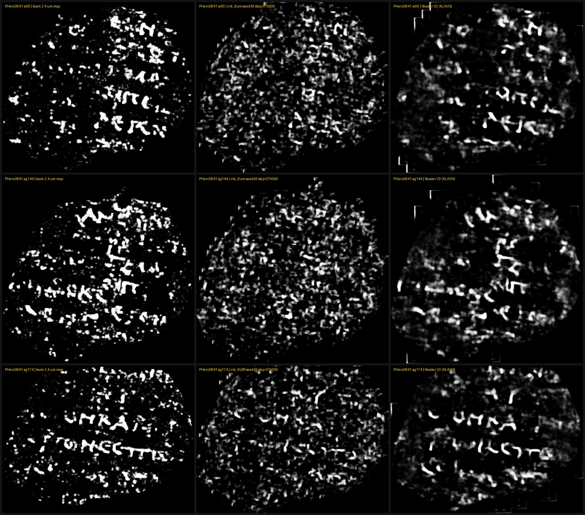

# 32 — Any ink checkpoint on any VC3D segment, opened in VC3D's own Ink Detection panel (`segment_ink`)

**Status: tool and checks, 2026-10-23 to 2026-10-28.** Code: [`tools/segment_ink.py`](../tools/segment_ink.py),
[`tools/check_segment_ink_alignment.py`](../tools/check_segment_ink_alignment.py) (usage in
[tools/README](../tools/README.md#segment_inkpy-check_segment_ink_alignmentpy--an-ink-model-on-one-segment-shown-in-vc3d)).
Evidence: [`runs/segment_ink/`](../runs/segment_ink). Every rule below was written down before the runs it
judges, but only in our own notes, not committed publicly first, so read it as a checked tool and a
reproduction, not as a pre-registered test. The Reader V3 comparison repeats a result KLAVIS (Domenico
Russo) published; it is not a new claim about that model.

**Update (2026-10-29): VC3D builds from villa main after #2358 no longer read these records.** #2358
(merged 2026-10-29, `e1aa625a6`) moved segments into VC3D's object store and rewrote the Ink Detection
panel. The panel now lists only the ink images published with a catalog surface: the files named in its
catalog record, downloaded the first time they are shown. The scan of segment folders for
`ink-detections.json` is gone. The records this tool writes still show in the 2026-09-19 build used in
Check 1 and in the "VC3D Latest" release of 2026-10-28 (villa `7154682e1`, before #2358). They do not show
in builds after it. The maps themselves (the JPEG and the raw TIFF) and every number below are unchanged;
only the last step, seeing them in VC3D's panel, is affected. On villa main `8ff06f762` we found no
supported way to put a locally made map on a surface in the new panel.

## The problem

VC3D can already show an ink map on a segment: its Ink Detection panel lists the records in a segment
folder's `ink-detections.json` (or, for catalog segments, `catalog-origin.json`) and stretches each image
over the segment's point grid. But the maps it can show are the ones the catalog ships. VC3D has service
managers that run Lasagna, NeuralTrace and the spiral fit from inside the viewer, and none for ink (villa
main `bbe7f8af6`, 2026-10-28: `*ServiceManager*` files mention no ink model). So someone who traces a new
segment, or who wants to compare a new checkpoint against the team's map on an old one, has to render a
surface volume, run inference, and then get the result onto the mesh in VC3D by hand. The first two steps
have a ready runner: LimeGS and pscamillo's [ink-sdk](https://github.com/LimeGS/ink-sdk) (MIT, started
2026-10-23, the same week as this tool) renders a tifxyz mesh with the same `vc_render_tifxyz` and runs
several 9 µm models in both directions, writing maps and a receipt. What this tool adds is the VC3D end:
the image and record the Ink Detection panel actually reads, next to the catalog's. The open-problems page
makes the same point from the other side: a prediction you cannot inspect on the geometry is hard to
validate.

## What the tool does

One command per segment: render the tifxyz mesh to a flat surface volume with VC3D's own
`vc_render_tifxyz` (28 slices, `--flip-normals`), run villa's unmodified
`vesuvius.ink_detection.inference.infer` with any checkpoint it can load, and add a record to the segment's
`ink-detections.json` so the map appears in the panel next to the catalog's. `--direction both` also writes a
second record with the layer order reversed. No VC3D change is needed.

Inputs and outputs are the formats the project already uses: a tifxyz folder in, the scan's OME-Zarr volume
for the render, a JPEG plus a JSON record out. Each record carries the checkpoint, its sha256, the render, the
layer direction and the path of the raw uint8 TIFF.

Three details that each cost a failed check before they were right:
- **JPEG, not TIFF.** VC3D drops every non-JPEG record of a segment that also has a JPEG record, and catalog
  maps are JPEGs, so a TIFF would vanish on exactly the segments people compare against.
- **Copy the catalog records first.** Once `ink-detections.json` exists VC3D reads it instead of
  `catalog-origin.json`; a file holding only our record hides the team's map (we ran that as the control).
- **Write both segment keys.** VC3D matches a record to a segment by folder name in builds since villa #2077
  (2026-10-13) and by the `meta.json` uuid before that, so each record carries both.

## Check 1 — VC3D reads it

VC3D main `322cb0899`'s overlay controller, built with the project's CI image, with cases added to its
existing `test_ink_detection_overlay` test: our records list and load on a plain segment, on the same segment
keyed by uuid (as older builds do), and next to a catalog record; 8 of 8 cases pass (the test's 4 and
our 4). On the 2026-09-19 release build, opened by hand, the panel shows the record on PHerc0139 w045 and
lays it on the grid unflipped.

## Check 2 — the map lands on the right pixels

On two segments the ink_9um checkpoints were not trained on, our map against the team's 2.4 µm catalog map
for the same segment. The number is the correlation of the two maps, each blurred (σ 2 px) and reduced to the
same size. Rule fixed before the runs: as-is must be the best of four flips, above 0.1, and above twice the
best map shifted by ±10%.

| segment | forward, as is | best flip | best shifted map | reversed layers |
|---|---|---|---|---|
| PHerc0814 20250925212701 | 0.220 | −0.02 | 0.042 | 0.035 (fails) |
| PHerc0139 w045 (20260126000000) | 0.389 | 0.078 | 0.081 | 0.017 (fails) |

This checks placement, not reading quality: at 9 µm ink_9um's letters are much fainter than the team's
([w045 side by side](../runs/segment_ink/pherc0139_w045_team_fwd_rev.png)). Our render of the PHerc0814 segment
also matches the team's published surface volume in the four chunks compared (99.6–99.75% of bytes; under
1.3% with the depth reversed), the orientation [docs/25 §8.1](25_scouting_eligible_volumes.md) had found.

## Example — swapping the checkpoint: ink_9um vs KLAVIS's Reader V3 on PHerc0841

Only `--checkpoint` changes. [Reader V3](https://github.com/DomRusso2/reader-v3) (MIT; weights
`huggingface.co/domenicor046/reader-v3` at `aee1d64`, re-saved without unpickling by
[`convert_thirdparty_ckpts.py`](../tools/convert_thirdparty_ckpts.py)) loads in villa's `infer` as is. The
two segments above are in Reader V3's training set, so this uses three PHerc0841 segments that neither model
trained on: ink_9um never saw PHerc0841, and Reader V3's `train_config.json` does not name it. Mesh on the
9.366 µm scan `20250821151531`, one render per segment, both directions, villa main `e2254ebe0`.

Three measurements per map:
- **placement**: the Check 2 correlation against the team's 2.4 µm map;
- **letter scale**: the same comparison after subtracting a ~48 µm blur from both maps, so only
  letter-sized structure counts (maps shifted by ±10% score ≤ 0.004);
- **AUC** against the open human ink labels (`ink-labels/.../20260918`, inside their supervision mask).

| PHerc0841 segment | placement | letter scale | AUC vs human labels |
|---|---|---|---|
| w00 (20260220213127) | 0.355 → **0.666** | 0.022 → **0.101** | 0.772 → **0.916** |
| ag144 (20260220214732) | 0.352 → **0.678** | 0.026 → **0.121** | 0.681 → **0.834** |
| ag174 (20260221022814) | 0.376 → **0.627** | 0.031 → **0.115** | 0.756 → **0.853** |

Each cell is ink_9um seed43 step-075000 → Reader V3, forward layer order. Mean AUC gain +0.131.



*Rows: w00, ag144, ag174. Columns: team 2.4 µm catalog map, ink_9um, Reader V3. Every map is on the team
map's grid and stretched from its own median to its 99.5th percentile; nothing is cropped.*

The rules were fixed on w00 before any inference and applied unchanged to ag144 and ag174 after the w00
result. Three predictions were written down; all three held: both models place correctly in the same
direction, Reader V3's AUC is at least 0.02 higher on at least one of the two later segments (+0.153 and
+0.097), and the mean gain over the three is at least 0.05 (+0.131).

Checked: AUC recomputed from a histogram on the label grid instead of the render grid gives the same
numbers to three decimals. KLAVIS's own published numbers for w00 are 0.881 (Reader V3) and 0.722 (the
baseline in KLAVIS's suite, not necessarily our ink_9um checkpoint), so the gap reproduces through a
different render path; ours are about 0.04–0.05 higher for both.
Reader V3 also ran 3–6× faster here (~25 s per direction against 74–157 s for ink_9um, RTX 5090).

## The layer direction is the setting that matters most

With the layers reversed, both models lose most of what they had, and on every segment the reversed map
fails the placement rule for ink_9um:

| PHerc0841 segment | ink_9um AUC, forward → reversed | Reader V3 AUC, forward → reversed |
|---|---|---|
| w00 | 0.772 → 0.598 | 0.916 → 0.566 |
| ag144 | 0.681 → 0.553 | 0.834 → 0.540 |
| ag174 | 0.756 → 0.617 | 0.853 → 0.575 |

That is why the tool writes both directions by default and why the placement check exists: on a segment
with no labels, comparing the two records against each other, or against a catalog map when there is one,
is the cheap way to find out which way the sheet faces. Sartoshirelli reported the same thing first,
with ink_9um on held-out segments that include these three (#robots, 2026-10-21; villa #1946), and picked
the direction without labels as the one whose output is more spread out; this table adds Reader V3 and the
VC3D path, not the finding.

## Limits

- One scroll (PHerc0841, 9.366 µm, 113 keV) for the model comparison, one ink_9um checkpoint, three segments.
  The placement check ran on two more scrolls, with ink_9um only.
- Reader V3's maps have a thin stepped outline along the canvas edge on all three segments (its 384 px
  tiles reach past the segment boundary). The band is mid-grey (mean 64–70 against 78 over the whole map),
  not ink-bright, and none of it overlaps the labels' supervision mask (0 pixels on each segment), so the
  AUCs above do not touch it.
- The rules were not committed publicly before the runs (see Status).
- Saving a segment over itself in VC3D currently deletes its subfolders (villa #2222, fix proposed in #2223),
  and a catalog segment that VC3D re-downloads is replaced as a whole folder; in both cases run the tool
  again. VC3D is moving its storage into a central object store (`vc_object_store`). When this was written
  (villa main `bbe7f8af6`), only fibers had moved and the ink panel still read the segment folder. Segments
  moved the next day (#2358; see the Update at the top), and the panel no longer reads the folder.

## Reproduce

```bash
PY=external/villa/ink-detection/.venv/Scripts/python.exe   # villa's ink-detection environment
$PY tools/segment_ink.py SEGMENT_DIR --scroll PHerc0841 \
    --volume 20250821151531-9.366um-1.2m-113keV-masked.zarr \
    --checkpoint data/ink_9um/models_ext/clean/klavis_reader-v3.pth --name klavis_reader-v3 --direction both
python tools/check_segment_ink_alignment.py WORK/<segment>_<name>.tif TEAM_MAP_ds8.jpg --out align.json
```

`SEGMENT_DIR` is the `mesh/<id>-on-<volume>-9.366um.tifxyz` folder of an open-data segment. Numbers:
[w00](../runs/segment_ink/pherc0841_w00_ink9um_vs_readerv3.json),
[all three PHerc0841 segments](../runs/segment_ink/pherc0841_ink9um_vs_readerv3_3seg.json), placement reports
for [PHerc0814](../runs/segment_ink/pherc0814_20250925212701_forward.json) and
[PHerc0139 w045](../runs/segment_ink/pherc0139_w045_forward.json) (each with its `_reverse` twin).

## Credits

Reader V3 is KLAVIS's (Domenico Russo); ink_9um and the 2.4 µm catalog maps are the Vesuvius Challenge
team's, as are the open ink labels; the render and inference are villa's own `vc_render_tifxyz` and
`vesuvius.ink_detection`. This tool only connects them.

AI disclosure: the code, runs and this text were produced by Claude (Anthropic) via Claude Code, directed by
Hyojun Kwon (khj1222), who chose the problem, the data and the decisions.
